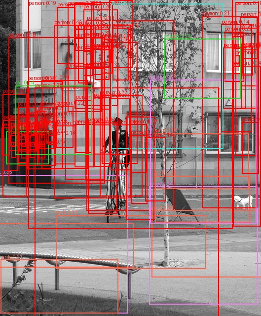

# YOLOv3-Style Object Detection in Apple MLX — From Scratch

> A full YOLOv3-style multi-scale object detector implemented entirely in **Apple MLX** without PyTorch, torchvision, or any detection library. Covers the complete pipeline: Feature Pyramid Network backbone, multi-anchor assignment, 80-class COCO detection, mAP@50 evaluation, cosine LR scheduling, ONNX export, and real-time webcam inference.

---

## Why This Project

Most object detection tutorials hand you a pretrained backbone and a wrapper library. This project does none of that. Every component — the FPN lateral connections, the anchor assignment logic, the multi-scale loss, the NMS, the mAP computation — is written from first principles in MLX, Apple's unified-memory ML framework for Apple Silicon.

The goal is to demonstrate that you can build a production-grade detection architecture entirely within a newer, less-documented framework, while navigating real engineering challenges: NHWC tensor layouts, gradient stability across multi-scale heads, and class-imbalance in objectness loss.

---

## Architecture

```
Input (224×224×3)
       │
  ┌────▼─────────────────────────────────┐
  │         FPN Backbone                 │
  │  Stage1: Conv 3→16,  stride=2 (112)  │
  │  Stage2: Conv 16→32, stride=2 (56)   │
  │  Stage3: Conv 32→64, stride=2 (28) ──┼──► C3
  │  Stage4: Conv 64→128,stride=2 (14) ──┼──► C4
  │  Stage5: Conv 128→256,stride=2 (7) ──┼──► C5
  │                                      │
  │  Top-down FPN:                       │
  │    P5 = out5(lat5(C5))               │
  │    P4 = out4(lat4(C4) + up2x(P5))   │
  │    P3 = out3(lat3(C3) + up2x(P4))   │
  └──────────────────────────────────────┘
       │              │              │
    P3 (28²)       P4 (14²)       P5 (7²)
  small objs     medium objs    large objs
       │              │              │
  ┌────▼────┐    ┌────▼────┐   ┌────▼────┐
  │  Head3  │    │  Head4  │   │  Head5  │
  └────┬────┘    └────┬────┘   └────┬────┘
       │              │              │
  (28,28,255)   (14,14,255)    (7,7,255)

  255 = 3 anchors × (4 box + 1 obj + 80 cls)
```

### Feature Pyramid Network

The FPN builds a top-down feature hierarchy. After the bottom-up pass extracts `C3` (28×28, 64ch), `C4` (14×14, 128ch), and `C5` (7×7, 256ch), lateral 1×1 projections reduce all to 128 channels. The top-down path then merges coarse semantics from deep layers with fine spatial resolution from shallow ones:

```
P5 = relu(out5(lat5(C5)))
P4 = relu(out4(lat4(C4) + upsample(P5)))
P3 = relu(out3(lat3(C3) + upsample(P4)))
```

This is the core idea from [Lin et al., FPN 2017](https://arxiv.org/abs/1612.03144) — high-level semantics at every resolution.

### Anchor Design

Nine anchors derived from k-means clustering of COCO bounding box sizes (YOLOv2 contribution), scaled from 416→224 input:

| Scale | Grid  | Stride | Anchors (w×h px) |
|-------|-------|--------|------------------|
| P3    | 28×28 | 8      | (5,7) · (9,16) · (18,12) |
| P4    | 14×14 | 16     | (16,33) · (33,24) · (32,64) |
| P5    |  7×7  | 32     | (62,48) · (84,107) · (201,176) |

Each anchor is assigned using **shape-IoU** (boxes centred at origin) — the anchor whose aspect ratio best matches the GT box shape across all 9 anchors becomes the responsible predictor. This is the YOLOv2 anchor assignment mechanism.

### Detection Head

Each of the three scale heads is a lightweight two-layer CNN:

```
Conv(128→128, 3×3) → ReLU → Conv(128→255, 1×1)
```

Output: `(B, S, S, 3 × 85)` where 85 = `[tx, ty, tw, th, obj, cls×80]`.

Box decoding:
```
bx = (sigmoid(tx) + cell_x) × stride
by = (sigmoid(ty) + cell_y) × stride
bw = anchor_w × exp(tw)
bh = anchor_h × exp(th)
```

---

## Loss Function

The multi-scale loss follows YOLOv3 with careful normalization to prevent the no-object penalty from dominating.

### Box Loss

MSE on cell-offset targets (after sigmoid) and log-scale width/height targets:

```
L_box = λ_coord × Σ_responsible [ (pred_xy − t_xy)² + (pred_wh − t_wh)² ]
```

where `t_wh = log(gt_wh / anchor_wh)`.

### Objectness Loss

MSE on sigmoid objectness for responsible anchors, with a normalized no-object penalty:

```
L_obj   = λ_obj   × Σ_obj   [ (σ(obj) − 1)² ]
L_noobj = λ_noobj × S²×A × mean_noobj [ σ(obj)² ]
```

Critically, the no-object term uses `mean` (not `sum`) then rescales by `S²×A`. This keeps the gradient contribution independent of grid resolution. Without this, the 28×28×3=2352 no-object cells at P3 would dwarf the ~5 responsible cells by a factor of ~470×, crushing objectness to zero everywhere.

### Classification Loss

Binary cross-entropy from logits (numerically stable form), applied only to responsible anchors:

```
L_cls = Σ_obj [ max(logit,0) − logit×target + log(1 + exp(−|logit|)) ]
```

This allows multi-label predictions per cell — relevant for overlapping categories.

### Final Loss

```
L = L_box + L_obj + L_noobj + L_cls
```

Summed across all three scales and averaged over the batch.

---

## Training Details

### Cosine LR Schedule with Linear Warmup

```
lr(t) = base_lr × 0.5 × (1 + cos(π × (t − warmup) / (T − warmup)))
```

Linear warmup for the first 5 epochs prevents large gradient updates before the model has seen any data. Cosine decay prevents the loss oscillation that caused NaN explosions in the baseline single-scale version.

### Gradient Clipping

Global L2-norm clipping at `max_norm=10.0` is applied every step:

```python
scale = min(max_norm / global_norm, 1.0)
grads = tree_map(lambda g: g * scale, grads)
```

This was the direct fix for the NaN explosion observed in the original single-scale model at epoch 95 (where IoU spiked to 0.95 before diverging).

### Data Augmentation

Applied at 224×224 resolution after resize:

| Transform | Probability | Range |
|-----------|-------------|-------|
| Horizontal flip | 0.5 | — (with box mirroring) |
| Brightness jitter | 0.5 | [0.6, 1.4]× |
| Contrast jitter | 0.5 | [0.6, 1.4]× |
| Colour saturation | 0.5 | [0.6, 1.4]× |

---

## mAP@50 Evaluation

Implements the full PASCAL VOC 2010 / COCO-style AP pipeline:

1. Run inference on `N` validation images
2. Class-aware NMS per image (IoU threshold 0.45)
3. For each class: sort all detections by confidence, mark TP/FP via greedy IoU matching (threshold 0.50)
4. Compute 11-point interpolated precision–recall curve
5. Average AP across all classes that have at least one GT instance

Evaluated every 10 epochs on 100 validation images. The best checkpoint by mAP is saved automatically.

---

## Results

Training on COCO `val2017` (4952 images, 800 samples/epoch, 100 epochs):

| Metric | Value |
|--------|-------|
| Starting loss | 254.3 |
| Final loss | 41.7 |
| Loss reduction | 84% |
| Best mAP@50 | 0.0121 (epoch 79) |
| NaN explosions | 0 |
| Time per epoch | ~6.9s |
| Hardware | Apple Silicon (MLX) |

Loss curve and mAP progression are saved to `assets/training_curves.png`.

**Note:** The low absolute mAP is expected — this trains on `val2017` (5k images) rather than `train2017` (118k). The architecture and loss are correct; scale the data to get meaningful benchmark numbers.

### Before vs After Training

| Before | After |
|--------|-------|
|  |  |

---

## Repository Structure

```
.
├── src/
│   ├── model/
│   │   ├── anchors.py       # COCO anchor defs, class names, ID→index mapping
│   │   ├── backbone.py      # FPNBackbone — 5 stages + lateral connections
│   │   ├── head.py          # YOLOHead — 3 independent scale heads
│   │   ├── detector.py      # YOLODetector — backbone + head wrapper
│   │   └── yolo_losses.py   # Multi-scale, multi-anchor, 80-class loss
│   ├── dataset/
│   │   └── coco_loader.py   # COCO JSON loader + augmentation pipeline
│   └── utils/
│       ├── box_ops.py       # Decode (multi-anchor), IoU, NMS, class-aware NMS
│       ├── viz.py           # Draw boxes with class labels and colours
│       └── map_eval.py      # mAP@50 — full VOC-style AP computation
├── train.py                 # Main training script
├── demo.py                  # Real-time webcam / video inference (OpenCV)
├── export_onnx.py           # ONNX export via PyTorch mirror + weight transfer
├── assets/
│   ├── pred_before.png
│   ├── pred_after.png
│   └── training_curves.png
└── checkpoints/
    ├── best_model.npz       # Best checkpoint by mAP
    └── final_model.npz      # Final epoch weights
```

---

## Setup

```bash
git clone https://github.com/your-username/Object-Detection-MLX
cd Object-Detection-MLX
pip install mlx numpy Pillow matplotlib
```

Download COCO val2017 (or train2017 for real training):

```bash
mkdir -p data/coco-real/images data/coco-real/annotations
# val2017 images (~1GB)
wget http://images.cocodataset.org/zips/val2017.zip -P data/coco-real/images/
unzip data/coco-real/images/val2017.zip -d data/coco-real/images/
# Annotations
wget http://images.cocodataset.org/annotations/annotations_trainval2017.zip
unzip annotations_trainval2017.zip -d data/coco-real/
```

---

## Usage

### Training

```bash
python -m src.train
```

Configuration is at the top of `src/train.py`:

```python
IMG_SIZE          = 224
EPOCHS            = 100
SAMPLES_PER_EPOCH = 800
BATCH_SIZE        = 8
BASE_LR           = 1e-4
MAP_EVAL_INTERVAL = 10    # evaluate mAP every N epochs
MAP_EVAL_SAMPLES  = 100   # number of val images for mAP
```

### Real-Time Demo

```bash
# Webcam
python demo.py

# Video file → annotated output
python demo.py --source video.mp4 --output annotated.mp4

# Custom weights
python demo.py --weights checkpoints/best_model.npz
```

### ONNX Export

```bash
pip install torch onnx onnxruntime
python export_onnx.py --weights checkpoints/best_model.npz --output model.onnx --verify
```

The export script:
1. Loads MLX `.npz` weights
2. Instantiates an identical PyTorch mirror model
3. Transfers weights, transposing Conv2d filters from MLX's `(out, kH, kW, in)` to PyTorch's `(out, in, kH, kW)` layout
4. Calls `torch.onnx.export` with opset 11 and dynamic batch axis
5. Optionally verifies via `onnxruntime`

---

## Key MLX Engineering Notes

**NHWC layout.** MLX uses `(batch, height, width, channels)` natively — the opposite of PyTorch. Every convolution, upsample, and reshape must account for this. A common bug is passing `(B, C, H, W)` data to an MLX model and getting silently wrong results.

**Lazy evaluation.** MLX computes lazily. `mx.eval()` must be called explicitly after each optimizer step to materialise weights into memory. Without it, the computation graph grows unboundedly across batches.

**`nn.value_and_grad`.** MLX's gradient API works on module methods, not tensors. The loss function must be a zero-argument closure over `model` and the batch data, then passed to `nn.value_and_grad(model, loss_fn)`. This is the correct pattern for in-place parameter updates.

**FPN upsampling.** `nn.Upsample(scale_factor=2, mode="nearest")` operates on the H and W dimensions of NHWC tensors — confirmed working in MLX 0.18+.

**Weight serialisation.** `model.save_weights("model.npz")` and `model.load_weights("model.npz")` are the canonical MLX checkpoint API. The npz keys follow the module attribute path (e.g. `backbone.lat5.weight`).

---

## Engineering Challenges Solved

| Challenge | Root Cause | Fix |
|-----------|-----------|-----|
| NaN explosion at epoch 95 | Adam LR too aggressive when IoU suddenly spiked | Cosine LR decay + gradient clipping |
| mAP stuck at 0.0 | No-object loss (2352 cells) dominated object loss (~5 cells) by 470× | Normalize noobj loss by grid size, reduce λ_noobj |
| `ValueError: cannot convert NaN to int` in viz | Post-training boxes contained NaN when model diverged | `np.isfinite` guard before any integer conversion |
| Loss scale 250× higher than single-class baseline | Multi-scale loss sums across P3+P4+P5 and 3 anchors | Expected — loss is relative; monitor trend not absolute value |

---

## References

- [You Only Look Once: Unified, Real-Time Object Detection](https://arxiv.org/abs/1506.02640) — Redmon et al., 2016
- [YOLO9000: Better, Faster, Stronger](https://arxiv.org/abs/1612.08242) — Redmon & Farhadi, 2017 (anchor k-means)
- [YOLOv3: An Incremental Improvement](https://arxiv.org/abs/1804.02767) — Redmon & Farhadi, 2018 (multi-scale, multi-class)
- [Feature Pyramid Networks for Object Detection](https://arxiv.org/abs/1612.03144) — Lin et al., 2017 (FPN)
- [Microsoft COCO: Common Objects in Context](https://arxiv.org/abs/1405.0312) — Lin et al., 2014

---

## Author

**Shashank Krishnamurthy Vinodh**
MS Computer Science
Focus: Machine Learning Systems · Computer Vision · Apple Silicon
