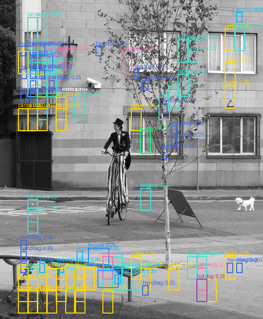

# YOLO-style Object Detection in MLX (from scratch)

This repository implements an end-to-end YOLO-style object detection pipeline using **Apple MLX**, built **from first principles** without PyTorch, torchvision, or pycocotools.

The goal of this project is not to build a production-grade detector, but to **understand and demonstrate object detection systems at the framework and loss-function level**, specifically on MLX.

---

## 🚀 Key Highlights

- MLX-native CNN backbone (NHWC-aware)
- YOLO-style detection head
- COCO-format dataset loader written from scratch
- YOLO-v1 style loss implemented from first principles
- Custom decoding, IoU, and Non-Max Suppression (NMS)
- End-to-end training loop using MLX optimizers
- Qualitative visualization before and after training

---

## 📌 Why this project matters

Most object detection implementations rely heavily on large frameworks and abstractions.
In contrast, this project demonstrates:

- Deep understanding of **YOLO detection mechanics**
- Correct handling of **MLX tensor layouts (NHWC)**
- Training stability issues in grid-based detectors
- Practical ML systems debugging on a newer framework (MLX)

This project is especially relevant for:
- ML systems engineers
- Applied ML researchers
- Engineers working on Apple Silicon or MLX-based workflows

---

## 🧠 Implementation Overview

### Model Architecture
- Simple CNN backbone using MLX `Conv2d`
- YOLO-style head predicting:
  - bounding box offsets
  - objectness score
  - class probability

### Loss Function
- YOLO-v1 style loss:
  - bounding box regression
  - objectness loss
  - background (no-object) loss
  - classification loss
- Implemented manually without helper libraries

### Training
- End-to-end backpropagation using MLX
- SGD optimizer
- Demonstrates known YOLO behavior on small datasets:
  - flat loss curves
  - reliance on qualitative evaluation

---

## 🖼️ Qualitative Results

### Before Training

### After Training

> Note: Due to the intentionally small dataset (COCO-mini), improvements are qualitative rather than quantitative. This behavior is expected and discussed in YOLO literature.

---

## 📂 Repository Structure

src/
├── dataset/ # COCO loader (from scratch)
├── model/ # backbone, head, YOLO loss
├── utils/ # box decoding, NMS, visualization
└── train.py # training loop
assets/
├── pred_before.png
└── pred_trained.png

---

## ⚠️ Known Limitations (Intentional)

- Very small dataset (COCO-mini)
- No anchors or feature pyramids
- No pretrained backbone
- Not intended for benchmark performance

These choices are deliberate to focus on **system understanding rather than leaderboard scores**.

---

## 🔮 Future Work

- Anchor-based YOLO variants
- Larger datasets (VOC / COCO)
- MLX vs PyTorch performance comparison
- Memory profiling on Apple Silicon

---

## 👤 Author

**Shashank Krishnamurthy Vinodh**  
MS Computer Science  
Focus: Machine Learning Systems, Computer Vision, Applied Deep Learning
